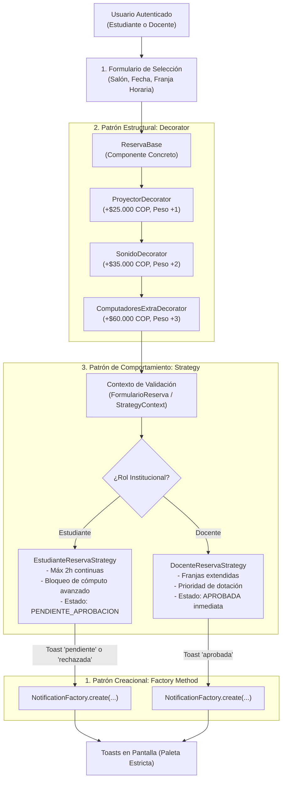
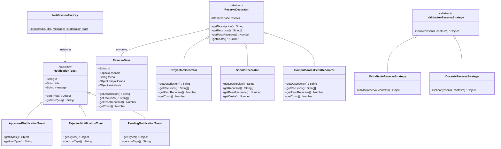

# EspaciosCompensar

> **Sistema de Gestión y Asignación de Recursos Académicos — Fundación Universitaria Compensar (UCompensar)**  
> **Campus Calle 42 | Periodo Académico: 2026-I**  
> **Arquitectura de Software:** Patrones de Diseño GoF (Gang of Four) — Creacional, Estructural y de Comportamiento.  
> **Stack Tecnológico:** React 18, Vite, JavaScript ES6+ (POO estricta), Tailwind CSS.

---

## 1. Descripción del Proyecto y Problema que Resuelve

En el campus institucional de **UCompensar**, la gestión y asignación de aulas, laboratorios y auditorios presenta tres desafíos críticos que frecuentemente provocan código monolítico y alta deuda técnica:

1. **Creación Polimórfica de Notificaciones (Desacoplamiento Creacional):**
   La interfaz debe comunicar retroalimentación visual inmediata ante múltiples eventos (login exitoso, credenciales inválidas, reservas aprobadas, solicitudes en revisión o saturación de espacios). El patrón **Factory Method** centraliza y desacopla la instanciación de toasts asegurando una paleta estricta institucional (naranja `#FF6600` para aprobados y gris carbón `#1F2937` para estados de error o revisión, eliminando el uso de colores no corporativos).

2. **Dinamismo en la Dotación de Recursos Extra (Explosión Combinatoria Evitada):**
   Una reserva física básica de un salón puede requerir equipamiento especializado adicional (proyector láser 4K, microfonía y consola de sonido, o kits de cómputo de alto rendimiento). Usar herencia tradicional exigiría decenas de subclases combinatorias (`ReservaConProyector`, `ReservaConProyectorYSonido`, etc.). El patrón **Decorator** permite envolver la reserva básica y acumular responsabilidades, recursos, costos e índices de carga operativa de manera transparente y en tiempo de ejecución.

3. **Flexibilidad en las Reglas de Negocio según el Rol (Intercambio de Algoritmos):**
   Las políticas de aprobación varían drásticamente entre estudiantes y docentes:
   - **Estudiantes:** Tienen un límite estricto de máximo 2 horas continuas, no pueden solicitar kits de cómputo avanzado de forma autónoma y su reserva pasa a estado *Pendiente de Aprobación*.
   - **Docentes:** Cuentan con aprobación automática inmediata, prioridad sobre equipamiento especial y acceso a franjas horarias extendidas.  
   El patrón **Strategy** encapsula estos algoritmos de validación en clases independientes, permitiendo alternarlas en tiempo de ejecución según el usuario autenticado.

---

## 2. Los 3 Patrones de Diseño GoF Integrados en el Flujo de Reserva

Los tres patrones cooperan dentro de un único pipeline de negocio continuo:



---

## 3. Mapeo de Clases y Roles GoF para Documentación UML

Cada archivo en `src/` incluye comentarios formales identificando su rol para facilitar el modelado en diagramas de clases y de secuencia UML:

### 3.1. Patrón Creacional: Factory Method
| Clase / Archivo | Rol GoF en UML | Responsabilidad |
|---|---|---|
| `NotificationToast` | `// Rol GoF: Product` | Clase base abstracta de notificación toast. |
| `ApprovedNotificationToast` | `// Rol GoF: ConcreteProduct` | Variante aprobada (`border-orange-500`, texto naranja `#FF6600`). |
| `RejectedNotificationToast` | `// Rol GoF: ConcreteProduct` | Variante rechazada (`border-gray-800`, texto gris carbón `#1F2937`). |
| `PendingNotificationToast` | `// Rol GoF: ConcreteProduct` | Variante en revisión (`border-gray-800`, acento corporativo). |
| `NotificationFactory` | `// Rol GoF: Creator` | Método estático `create()` que instancia dinámicamente el producto adecuado. |

### 3.2. Patrón Estructural: Decorator
| Clase / Archivo | Rol GoF en UML | Responsabilidad |
|---|---|---|
| `ReservaBase` | `// Rol GoF: Component / ConcreteComponent` | Representa la reserva simple de un espacio académico. |
| `ReservaDecorator` | `// Rol GoF: Decorator` | Clase abstracta que mantiene la referencia a la reserva y delega operaciones. |
| `ProyectorDecorator` | `// Rol GoF: ConcreteDecorator` | Añade proyector 4K y HDMI/USB-C (+peso 1, +$25.000 COP). |
| `SonidoDecorator` | `// Rol GoF: ConcreteDecorator` | Añade microfonía Shure y consola digital (+peso 2, +$35.000 COP). |
| `ComputadoresExtraDecorator` | `// Rol GoF: ConcreteDecorator` | Añade 20 laptops GPU RTX y switch de red (+peso 3, +$60.000 COP). |

### 3.3. Patrón de Comportamiento: Strategy
| Clase / Archivo | Rol GoF en UML | Responsabilidad |
|---|---|---|
| `ValidacionReservaStrategy` | `// Rol GoF: Strategy` | Interfaz común con el método `validar(reserva, contexto)`. |
| `EstudianteReservaStrategy` | `// Rol GoF: ConcreteStrategy` | Aplica límite de 2h, restringe cómputo avanzado y genera estado pendiente. |
| `DocenteReservaStrategy` | `// Rol GoF: ConcreteStrategy` | Permite bloques largos, aprueba automáticamente y concede prioridad. |
| `FormularioReserva` | `// Rol GoF: Context` | Contexto cliente que delega la validación a la estrategia correspondiente. |

---

## 4. Diagrama de Clases UML Consolidado



---

## 5. Estructura de Carpetas del Proyecto

```
EspaciosCompensar/
├── .gitignore                            # Exclusiones estándar Git (node_modules, dist, etc.)
├── package.json                          # Configuración npm y scripts de ejecución
├── vite.config.js                        # Configuración para compilación y servidor Vite
├── index.html                            # Punto de entrada HTML con CDN Tailwind
├── README.md                             # Documentación técnica completa
└── src/
    ├── models/                           # Modelos del dominio
    │   ├── Espacio.js                    # Entidad de salón/laboratorio/auditorio
    │   └── ReservaBase.js                # Componente base para el Decorator
    │
    ├── patterns/                         # Patrones de diseño GoF
    │   ├── creational/
    │   │   └── NotificationFactory.js    # Factory Method para Toasts
    │   ├── structural/
    │   │   ├── ReservaDecorator.js       # Decorador base abstracto
    │   │   ├── ProyectorDecorator.js     # Decorador Proyector 4K
    │   │   ├── SonidoDecorator.js        # Decorador Microfonía y Sonido
    │   │   └── ComputadoresExtraDecorator.js # Decorador Kit Laptops GPU
    │   └── behavioral/
    │       ├── ValidacionReservaStrategy.js # Interfaz Strategy
    │       ├── EstudianteReservaStrategy.js # Reglas Estudiante (2h máx, pendiente)
    │       └── DocenteReservaStrategy.js    # Reglas Docente (inmediata, prioridad)
    │
    ├── components/                       # Componentes React modulares
    │   ├── Navbar.jsx                    # Barra superior corporativa
    │   ├── Sidebar.jsx                   # Menú lateral naranja (#FF6600)
    │   ├── Calendario.jsx                # Calendario accesible (UX corregida)
    │   ├── FormularioReserva.jsx         # Formulario con Decorator y Strategy
    │   └── ToastContainer.jsx            # Contenedor de notificaciones
    │
    ├── config/
    │   └── SpaceConfig.js                # Catálogo y credenciales institucionales
    │
    ├── App.jsx                           # Integración completa de vistas y patrones
    └── main.jsx                          # Montaje del Virtual DOM
```

---

## 6. Cumplimiento Visual y Corrección de Antipatrones de UX

1. **Paleta Estricta Inamovible:**
   - **Naranja Primario:** `#FF6600` (`bg-orange-500`, `hover:bg-orange-600`, `text-orange-500`, `border-orange-500`).
   - **Blanco Puro:** `#FFFFFF` (`bg-white`).
   - **Gris de Fondo:** `#F9FAFB` (`bg-gray-50`).
   - **Gris Carbón (Estados Negativos/Auditoría):** `#1F2937` (`border-gray-800`, `text-gray-800`, `bg-gray-100`).
   - **Prohibición Total:** Ningún elemento utiliza azul, verde o rojo.

2. **Correcciones Heurísticas de Usabilidad:**
   - **Login de Estudiantes:** Se eliminó el fallo silencioso. Se proporciona retroalimentación instantánea (toast naranja si accede o alerta gris carbón si hay error).
   - **Calendario Accesible:** Los días disponibles se diferencian claramente de los no disponibles (fondos contrastados, cursor pointer vs. not-allowed con tachado sutil y leyenda visible).
   - **Franjas Horarias:** Se presentan en una grilla accesible de botones con su duración explícita en horas (2h o 3h), evitando bloqueos visuales o pantallas ciegas.

---

## 7. Instrucciones de Ejecución Local

### Prerrequisitos:
- **Node.js:** Versión 18.0 o superior (recomendado v20.x o v24.x).
- **npm:** Versión 9.0 o superior.

### Comandos:

1. **Instalar dependencias:**
   ```bash
   npm install
   ```

2. **Iniciar servidor de desarrollo:**
   ```bash
   npm run dev
   ```
   *La aplicación abrirá automáticamente en `http://localhost:5173`*.

3. **Compilar para producción:**
   ```bash
   npm run build
   ```

---

## 8. Credenciales Demo para Pruebas de QA

| Rol | Usuario | Contraseña | Comportamiento Estratégico (Strategy) |
|---|---|---|---|
| **Docente** | `carlos.mendoza@ucompensar.edu.co` | `password123` | **`DocenteReservaStrategy`**: Admite todos los decoradores, aprueba automáticamente y emite toast de confirmación. |
| **Estudiante** | `estudiante.demo@ucompensar.edu.co` | `password123` | **`EstudianteReservaStrategy`**: Máximo 2h, restringe computadores extra y emite toast de solicitud radicada en revisión. |
| **Administrador** | `laura.pardo@ucompensar.edu.co` | `admin2026` | Acceso con privilegios de gestión de planta física. |

---

## 9. Instrucciones de Despliegue a GitHub

Para sincronizar este proyecto con tu repositorio remoto:

```bash
git init
git add .
git commit -m "feat: sistema de gestion y reserva UCompensar con patrones GoF (Factory Method, Decorator, Strategy)"
git branch -M main
git remote add origin https://github.com/Elmala02/EspaciosCompensar.git
git push -u origin main
```
